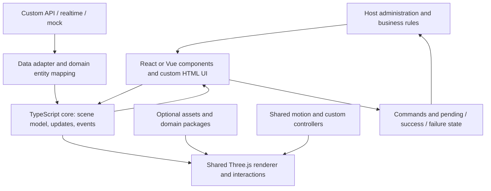

# Proposed architecture

Status: **the target architecture, with an initial implementation now available**. Core, the Three.js renderer (`@opsorama/three`), the object catalog (`@opsorama/objects`), React, and Vue exist as private workspace packages. The broader packages and contracts below remain proposals. See the [roadmap](ROADMAP.md) for what is implemented and planned. The `@opsorama/*` names identify the private local Opsorama workspace packages. Proposed packages below remain proposals; npm scope ownership and publication are unverified.

## Layer boundaries



### 1. Core

Contains data types, the node model, identifiers and relationships, update application, selection, and the event contract. It imports neither React, Vue, Three.js, DOM, Next.js, nor Zustand. This allows updates and mapping to be tested outside the browser.

Core uses plain TypeScript and a small subscription interface. Hosts can use Zustand, Redux, Pinia, or custom state. Framework wrappers connect subscriptions to their native lifecycle.

### 2. Shared renderer

Implemented camera interaction now includes primary-mouse drag panning on the canvas, with a 5-pixel click/drag threshold, pointer capture and explicit cleanup. It preserves domain positions and selection; framing/overview return to their targets. HTML labels/controls remain separate click targets; touch dragging and camera rotation remain outside this slice.

The Three.js renderer owns the canvas, camera, raycasting, highlighting, renderable asset registry, and frame loop. Renderable objects and asset factories are not React components. In the standard integration, React and Vue register and update nodes in the same renderer.

The renderer instances repeated identical meshes of different nodes automatically. Original meshes remain hidden picking/bounds/anchor proxies, while batches own independent geometry/material clones and instance buffers. The core contract is unchanged, and native JavaScript/React/Vue share one mount-time `instancing` option (default `true`) for comparisons and debugging. It replaced an earlier opt-in experiment, described in [static instancing](STATIC_INSTANCING.md).

Native Three.js is the proposed choice for a shared rendering foundation, rather than the only possible approach. Three.js provides a scene, camera, and renderer independently of a frontend framework. [Official introduction](https://threejs.org/manual/pages/creating-a-scene.html).

Do not rewrite the current React Three Fiber demo in one step. First validate the renderer on a small scene, then port individual procedural assets. An optional bridge for advanced R3F integrations may be considered later; the MVP must not introduce two rendering owners for one canvas.

### 3. Framework adapters

React provides JSX components, hooks, refs, and controlled props. Vue provides components/SFCs, composables, slots, and native emit/v-model conventions. Adapters handle registration, prop updates, subscriptions, and cleanup. Prop meaning, units, event payloads, and resulting scenes remain consistent. Both adapters render the same loading indicator markup and styles from `@opsorama/three` and let hosts replace its content.

Vue must not host a hidden React application. Web Components support would be an additional embedding option over the same core, rather than a prerequisite for native adapters. Vue can both create and consume Web Components, but this does not replace an application's complete component and reactivity model. [Official Vue documentation](https://vuejs.org/guide/extras/web-components.html).

### 4. UI, assets, and recipes

HTML UI is optional. The toolkit provides selection, marker projection, and relevant data; hosts can supply their own inspectors, KPIs, dialogs, and tables. Prebuilt UI must not require Tailwind, shadcn, or a particular design system.

The optional generic panel family is now implemented in `@opsorama/ui`, with separate `/dom` and stylesheet exports plus native `@opsorama/react/ui` and `@opsorama/vue/ui` entry points. Shared typed presentation builders contain no framework/DOM/scene dependency. Panels accept host-controlled values, content, statuses and callbacks; layout, data sources and business semantics stay with the host. Existing root scene-selection inspectors remain compatible. See [the panel contract](DATA_PANELS.md).

Domain examples pair list entries with static WebP thumbnails of the corresponding catalog model. The website loads these as ordinary images. Regenerate them with `node apps/site/scripts/capture-hud-thumbnails.mjs` using Playwright Chromium. Example HUDs use a shared status treatment with a text label, a tone and an icon.

A detail panel can also show the selected object itself. `createNodePreview` in `@opsorama/three`, wrapped by `NodePreview` in both adapters, draws a live copy of one node and its visible descendants (attached nodes, and the interior of an open building) in a separate small canvas with its own WebGL context. It reads the scene's store, so state, count, theme and palette changes rebuild the copy and model animation follows the scene's motion settings; it never selects or writes to the store. The copy sits on a slow turntable that the viewer can turn by drag or arrow keys, and it draws only while something moves. Routes, controllers and transfers are left out of the copy, so nothing travels inside it.

Domain models are opt-in. Warehouse assets belong in the warehouse package; generic zones, objects, paths, and states belong in shared layers. A recipe combining buildings, vehicles, and shipment UI does not change the core domain model.

## Proposed packages and repository

| Package | Responsibility | Required framework dependencies |
| --- | --- | --- |
| `@opsorama/core` | Schemas, scene model, selection, updates | None |
| `@opsorama/three` | Three.js rendering, camera, picking, motion playback, instancing, resource lifecycle; no built-in models | None; Three.js only |
| `@opsorama/objects` | Catalog model factories, descriptors and definitions, and the `catalogAssets` registry | None; Three.js and `@opsorama/three` |
| `@opsorama/react` | Component adapter and hooks | React as a peer dependency |
| `@opsorama/vue` | Component adapter and composables | Vue as a peer dependency |
| `@opsorama/ui` | Optional HTML presentation contracts/builders, separate DOM mount and scoped CSS | None |

Motion starts as a small renderer module; generic data sources start as core contracts and examples. Separate `motion`, `data`, or `ui-*` packages should be introduced only when independent distribution becomes useful. Core, three, objects, React, Vue and the optional UI package are implemented. The renderer has no built-in models: a host passes an asset registry such as `catalogAssets` from `@opsorama/objects`, its own factories, or both merged with `createAssetRegistry`. The catalog is split into 21 kits that mirror the object browser categories; each has its own subpath (for example `@opsorama/objects/vehicles` exports `vehiclesKit`), `catalogAssets` merges all of them, and `CATALOG_KITS` lists the kit names. `pnpm measure:bundles` bundles typical imports with esbuild (minified, `three` external); `pnpm check:bundles` also enforces size budgets. On November 5, 2026 it reported 59.6 KiB for the renderer alone, 308.1 KiB with `catalogAssets`, and 87–116 KiB with the renderer and one kit. Other bundlers have not been measured. Connector packages remain planned.

```text
apps/
  site/                     # documentation website, object browser and domain examples (private, never published)
packages/
  core/                     # @opsorama/core
  three/                    # @opsorama/three
  objects/                  # @opsorama/objects (kits under src/kits/)
  ui/                       # @opsorama/ui
  react/                    # @opsorama/react
  vue/                      # @opsorama/vue
examples/                   # standalone starters: vanilla, vite-react, vite-vue, next
tests/                      # workspace-wide unit tests
scripts/                    # build, package, bundle and boundary checks
docs/                       # architecture, guides and domain notes
```

Do not create empty packages in advance; a new package needs a concrete, independently useful responsibility.

## Model-native status and explicit operation

Native status is limited to the eight device/indicator keys in renderer `assetVisualStates`. Other models remain neutral while host alert metadata, quantity aggregation and label priority remain available. `heatEnabled` (heated-pass, espresso-machine, pizza-oven), `waterRunning` (deck-shower), `fillLevel` (trough, 0–1), `display.running` and `localMotion` express physical appearance independently. These shared typed node props pass through JavaScript, React and native Vue. Domain recipes compose separate alert markers and HTML UI rather than adding business status parts to generic geometry.

## Model and identity

- **Domain entity:** an order, shipment, team, or machine; the host owns the data.
- **Scene node:** a visual representation with a `nodeId`, optional `entityId`, asset type, transform, and state.
- **Asset:** a model or procedural factory returning a renderable object with a cleanup contract.
- **Behavior:** an animation prescription reacting to state or commands; it is separate from business rules.
- **Recipe:** a documented composition of these layers for a particular administration use case.

One entity can have multiple nodes, such as an order represented by an object in a zone and a marker in an overview. Selection therefore includes both `nodeId` and `entityId`. Decorations may have only a `nodeId`. Duplicate node IDs are errors, rather than silent replacements.

Scenes initially use metric units, Y-up coordinates, and radians for rotations. Models declare pivots, dimensions, and scale. Metaphorical HR and workflow scenes use the same coordinates without presenting them as geographic or physically accurate data.

## Commerce campus composition

The commerce recipe now binds its visual records to six shared building containers using local parentId transforms, with independent attached carts/payloads. Its translation-only fixture adapter supplies world navigation slots; this is recipe code rather than a new core transform API. A compatible front cutaway and optional renderer fitted framing support inspectable interiors. Controlled presentation preferences and expanded-map UI remain outside business records and the core.

## Object catalog foundation

Current status (October 29): all 161 registered assets have checked descriptors; the earlier migration limits in this section no longer apply. `model-origin` explicitly preserves asymmetric/elevated placement, and `colorRole` can name several roles for legacy multi-part colors. Geometry snapshots and named anchors are declarative data; importing descriptors does not build models. Instance roles override legacy color, with fixed decoration disclosed. Hardware lifecycle profiling remains incomplete.

The commerce composition slice adds core `ContainerContents` and `Attachment`, static open/closed cartons, worker/cart coupling, a three-model `describeComposition` descriptor and world anchor queries through `SceneRenderer.getAnchor`. Children retain independent resources/identities; business transitions remain host/recipe-owned. The original recipe ran it through native React, Vue and JavaScript; it was replaced by a single-adapter domain example. Hardware profiling remains incomplete.

The display/time subset adds immutable `AssetNode.display` / native adapter inputs, kept separate from quantities, measured gauges and artwork. Monitor/board screens reuse the existing `surfaceLabel` decoder; clocks/timers advance optional relative visual time through the shared renderer clock without owning a scheduler, system clock or source records. All seven definitions have checked descriptors, inherited semantic palette roles, partial instance materials, local anchors/bounds and owned-resource teardown. `SceneRenderer.getAnchor` resolves transformed anchors.

The laboratory slice adds MaterialOverrides to SceneSettings.palette and AssetNode.materials. Core validates and snapshots maps; renderer passes scene roles to factories. Laboratory models resolve theme -> scene -> compatibility color -> instance overrides and rebuild inherited colors on palette changes. Checked descriptors now cover laboratory and legacy models; nested laboratory anchors have unique namespaces.


The building container is implemented. `AssetNode.building` controls a neutral shell and static cutaway; `SceneNode.parentId` uses building-local transforms. Closed or unresolved interiors are excluded before asset factories run. The optional core `bindBuildingInterior` loads host-mapped children on opening, cancels pending work and caches data separately from disposable render resources. The scene's light/midnight theme supplies building wall/roof/floor/trim roles with partial instance overrides. Native JS/React/Vue examples run at `/examples/buildings`; the implemented reference is `/docs/buildings`. General SceneGroup remains planned.

Adopted direction: prioritize reusable definitions before further recipe-specific geometry. The [object contribution guide](CONTRIBUTING_OBJECTS.md) defines what a complete catalog object needs. The runtime contract began with the parcel: core `ObjectDescriptor` data, renderer-side `checkAssetDescriptor` verification against the built model, and catalog pages rendered from the descriptor. Every registered asset now has a passing descriptor; new entries must do the same.

Core should hold plain typed descriptors, semantic palette references, capabilities and node configuration. Three.js factories, materials, picking, resolved anchors and animation execution belong in the renderer or optional asset modules. React/Vue consume the same definitions. Keep domain mapping, host commands and optional behavior bindings outside geometry; palette inheritance does not require class inheritance.

Every asset declares its supported scene palette roles, fixed decoration, instance overrides, useful static appearance and interaction bounds/anchors. Global motion-off and reduced motion gate local animation. Legacy `color` mappings are explicit; primary parts of older models now inherit scene roles while listed decorative tones remain fixed. Primitive palette support and extracting separate asset packages remain future work.

The catalog presentation is separate from the runtime descriptor. `/docs/objects` uses static thumbnails and one shared-renderer detail preview, with descriptor tables and resource teardown. Its searchable inventory metadata is not a new core schema or asset package.

## Quantity and representation

The primary quantity presentation now uses model-specific finite counts and disclosed symbolic multipliers. Core owns generic AssetCountDefinition/CountRepresentation validation and optional AssetNode.count/multiplier fields. Renderer-three owns concrete count definitions and geometry; React/Vue/JavaScript pass the same inputs. Count changes shape while the multiplier changes its interpretation. The [bounded count design](QUANTITY_SCALING.md) describes the implementation.

Source records, actual totals, unit of measure, identities and the calculation of symbolic scale/multipliers remain host-owned. A counted composition selects one node; visible parts never imply physical identities. Invalid ranges, discrete variants, fractional values and overflow are rejected.

The former exact unit API (QuantityLayer) was removed. Hosts that need unit identity map each unit to its own node with an `entityId` and page large sets in their own code.

## Data sources and updates

Measured indicators now use a separate optional `AssetNode.measurement` input for exact decimal readings, ranges, units, targets and threshold bands. Core validates and snapshots it; the renderer owns gauge geometry and automatic reading labels; native React/Vue pass the same typed input. Counts, multipliers and QuantityTargets cannot be combined with a measurement. The [indicator reference](INDICATORS.md) records this implemented slice.

Proposed contract, not an existing API:

```ts
interface EntitySnapshot<T> {
  entities: readonly T[];
  revision: string;
}

interface EntityPatch<T> {
  eventId: string;
  entityId: string;
  revision: string;
  operation: 'upsert' | 'remove';
  value?: T;
}

interface DataSource<T> {
  load(signal: AbortSignal): Promise<EntitySnapshot<T>>;
  subscribe(handlers: {
    onPatch(patch: EntityPatch<T>): void;
    onConnection(state: 'connecting' | 'live' | 'stale' | 'offline'): void;
    onError(error: Error): void;
  }, afterRevision: string): () => void;
}
```

Each source defines revision meaning and ordering; a timestamp alone does not guarantee order. `afterRevision` must connect the snapshot to subsequent changes. If the upstream system has no replay/cursor, the adapter begins buffering before loading the snapshot and resynchronizes after reconnecting. Both strategies still need documentation and tests.

The `entity → node` mapper determines the model, position, state, and path binding. The API does not require every business change to arrive over WebSocket; smaller applications can provide props or periodic HTTP updates.

The renderer interpolates between confirmed positions. These transitional values are not new domain data. Removing an entity cancels its behavior and selection; a snapshot without an object must not leave a ghost on the scene.

## Commands and business actions

Clicking “move shipment” emits a typed command to the host application, which validates and writes to its system. The dashboard tracks `pending/success/failure`; confirmed state comes from the source or the confirmed action result. Optimistic updates are an optional policy with rollback.

Core does not implement permissions or a backend. Mapping UI commands to WMS, commerce, or HR APIs belongs in the integration layer. The current demo simulator imitates this boundary through local updates.

## Motion and custom extensions

Basic behaviors include transform interpolation, following a path, stopping at a node, waiting in a queue, and visual state transitions. A new target supports interruption, replacement, or queuing; document the default policy in the API.

**Implemented movement slice:** movement is split into four layers:

1. **Movement graph (implemented):** points and edges with lanes, one-way travel, agent/lane allow lists, speed limits and optional capacities. Core plans the cheapest permitted route and checks routes supplied by the host.
2. **Interaction slots on catalog objects (implemented):** approach point, interaction position, heading and pose. One agent per slot; slot groups express capacity.
3. **Behaviors and reservations (implemented):** a seeded, event-ordered runner for move/interact/wait steps, with slot reservations, first-come queues at queue points, typed blocking and host reassignment. A debug overlay draws the graph, slot occupancy and routes. Custom per-frame controllers are implemented (see motion controllers below); visual interaction effects remain planned.
4. **Route following (implemented):** `AssetNode.route` carries points, speeds, timed stops, loops and an end heading.

**Motion profiles and goals (implemented):** each agent kind declares acceleration, turn rate, a turn-in-place threshold and a corner speed in its graph rule. The profile travels with the route, so simulation and visual timing stay identical. `assetMotionProfiles` provides catalog defaults for mobile models. Behaviors accept goals: a point, the nearest point to a world position, or an object's slots. They pick the nearest free slot, accept optional `via` points and report typed events. `runner.command` assigns a goal, so hosts state where to go and what to use rather than scripting each step. Steered vehicles round corners with `cornerRadius`; the arc is a path shape only, so timing stays on the polyline.

**Carried items (implemented; checked through handling state with the runner's `handling` option):** agents with a carry rule pick items up and put them down when an interaction ends. The runner tracks only where each host-owned item is: held at an agent anchor, resting on an object anchor, or in the world. `itemNode` maps placements onto attachments, so every adapter renders them without new runtime code. Host item rules (`onItemEvent`) run at simulation time. `CarryRule.handOverSeconds` exchanges items before an interaction ends, and the renderer animates the change of parent for nodes with an `AssetNode.transfer`; `CarryRule.reach` limits pick-ups by item ID.

**Capacity and yielding (implemented):** points, edges and lanes may limit how many agents they hold at once. The behavior runner converts each planned trip into time-windowed holds on limited points and edges. An agent whose way is held waits where it stands, or detours when that arrives sooner. Holds are claimed in request order, so access is first come, first served. Waits are scheduled runner events rather than renderer pauses, so simulation and visual timing stay identical for any tick size. Unlimited points remain open junctions. There is no physics or steering. Agents that must swap two limited points are reported as deadlocked (`AgentState.deadlock`, `deadlock` event) and wait until the host reassigns one; `runner.getHolds()` and `navGraphOverlay` show the holds. A wait behind an agent that finished, is idle or is blocked is reported as stalled (`AgentState.stalled`, `stalled` event).

While a node has a route, the follower owns its root position and heading. Local animators only pose the model, using `locomotion.moving`. Replacement uses the **join** policy: the agent continues to the first upcoming point shared with the new route, so it never leaves permitted lanes or jumps; routes with no shared point are bridged directly. The behavior runner plans a host command during travel from the same join (`routeJoin`, `joinRoutes`), so its holds and arrival times match the visuals. Motion-off and reduced motion take precedence over pause and show the confirmed end of a one-way route. A newly mounted renderer starts a route at its `NodeRoute.elapsed`, which the host derives from its own clock (for behavior agents, `behaviorNode(state, base, { time })`). Business rules stay in the host; the graph expresses only spatial/visual policy.

**Motion controllers (implemented):** `AssetNode.controller` names a controller kind with JSON options. The renderer resolves the kind in `basicControllers` (`approach`, `follow`) plus the host's registry.
- Each visual frame, a controller receives the delta, the node's pose and a context: the latest node and other nodes' poses. It returns a root pose; it needs neither React rendering nor Vue reactivity.
- Lifecycle: the factory starts it, `update` runs on animated frames, `settle` runs while motion is off or reduced, and `cancel(reason)` runs once when the spec changes, the node is removed or the renderer is disposed.
- A controller and a route are exclusive owners of the root transform.

The host owns simulation time: it advances the behavior runner (or its own model) from its clock and passes route progress (`NodeRoute.elapsed`) derived from it. The renderer owns only the visual clock: pause/resume, playback speed, its 50 ms per-frame cap and the reduced-motion policy. A host that wants visuals and simulation in step advances the simulation with the same speed, pause and cap. Server events update target state; the view need not wait for an earlier animation to complete. Reduced motion preserves the meaning of a state change through alternatives such as a quick reposition and a text announcement.

Asset factories can return custom `THREE.Object3D` instances. The public renderer context provides controlled extension points rather than unrestricted replacement of another renderer's state. GLTF imports, advanced materials, and additional scene bridges follow the basic procedural implementation.

## Performance, embedding, and lifecycle

- One renderer and frame loop per scene; pause unnecessary work while its tab or panel is hidden.
- DOM mounts, resize observers, listeners, subscriptions, and GPU resources have explicit owners and cleanup.
- Share or instance repeated objects; removing one object must not dispose a shared material.
- Apply one shared shadow policy in the renderer instead of per model: narrow or contained details do not cast, and indoor nodes (inside a building container or on a declared `interior` area) neither cast nor receive.
- Merge each built node's static parts in the renderer instead of per model: meshes that differ only in base color merge into one mesh per material and shadow-flag group, with the color in vertex colors. Animators declare the parts they change with `setAssetAnimator(object, animator, animatedParts)`; those parts stay separate and merge their own static children. `keepPartsSeparate` opts other parts out.
- Instance repeated meshes across nodes in the renderer: at least `INSTANCING_MIN_COUNT` (4) meshes with byte-identical geometry and a material that differs only in base color draw as one `InstancedMesh`, with the color as instance color. The originals stay as hidden proxies for picking, anchors and bounds, and the frame loop copies their world matrices and visibility into the batch. Declared animated meshes, `keepPartsSeparate` parts, transparent and mirrored parts are never instanced. Batches own cloned geometry and material, so removing a node never disposes a shared resource.
- Bound rendered units, aggregate nodes and labels through bounded model counts and host-side paging. Measure costs and keep exact totals and warnings accessible at every detail level.
- Avoid business-state updates and unnecessary framework renders at 60 Hz.
- Support embedding inside a panel as well as a full-screen layout.
- Initialize rendering on the client during SSR; importing core must not require `window` or `document`.
- Load heavy scenes in steps. The renderer builds the initial scene in time slices (`buildBudget`, 12 ms by default, at least one node per slice) and yields to the browser between them, compiles shaders before the first frame (in the background where `KHR_parallel_shader_compile` is available), and only then draws. A loading indicator covers the scene until the first frame: the renderer's own DOM indicator in plain JavaScript, and in React and Vue an indicator that is also server-rendered, so it covers script download too. It fades in after 200 ms, animates only transform and opacity, and exposes progress as an ARIA progress bar. `onLoad` reports each step and `SceneRenderer.loaded` resolves after the first frame. Later store changes still build at once; slicing them would show half-built scenes.
- Use scoped CSS and CSS variables instead of global resets. The host controls size, fonts, and overlay layout.
- Provide an HTML state overview and recovery when WebGL is unavailable or its context is lost.
- Verify React StrictMode mount/unmount and Vue unmount.

## Package builds

Workspace consumers import package sources through each package's `exports` (`src/`). Published tarballs use `publishConfig.exports` instead, which point to `dist/`:

- `pnpm build:packages` builds every package with tsup into ESM JavaScript with source maps and bundled `.d.ts` declarations, one output per `exports` entry; `@opsorama/objects` also gets `dist/catalog.json`, a machine-readable index of every kit and asset descriptor.
- All packages are ESM-only and declare `"sideEffects": false` (`@opsorama/ui` keeps its CSS as a side effect).
- `pnpm check:packages` packs each package with pnpm, runs publint, type-checks an import of every entry point from a clean project with `bundler` and `node16` resolution, and imports every entry point in Node.
- `pnpm smoke:starters` copies each starter in `examples/` to a temporary folder, installs it from the packed packages (pnpm overrides point every `@opsorama/*` dependency at a tarball) and runs its type check and production build.
- The website builds as a static export for Cloudflare with `pnpm build:static` (`apps/site/out`); `apps/site/public/_redirects` replaces the Next.js redirects there.
- GitHub Actions run the checks on every pull request (`ci.yml`: typecheck, lint, unit tests, package checks, bundle budgets, starter smoke test, static site build), Playwright against the production build on every push to a pull request and on demand, without the `@measure` tests (`e2e.yml`), CodeQL and dependency review (`security.yml`). Site deployment to Cloudflare Pages (`site.yml`) runs while the repository variable `SITE_DEPLOY_ENABLED` is `true`; Changesets releases with npm provenance (`release.yml`) stay switched off until `RELEASE_ENABLED` is set.
- Versions use Changesets with one shared version for all `@opsorama/*` packages; see `.changeset/README.md`. Nothing is published yet.
