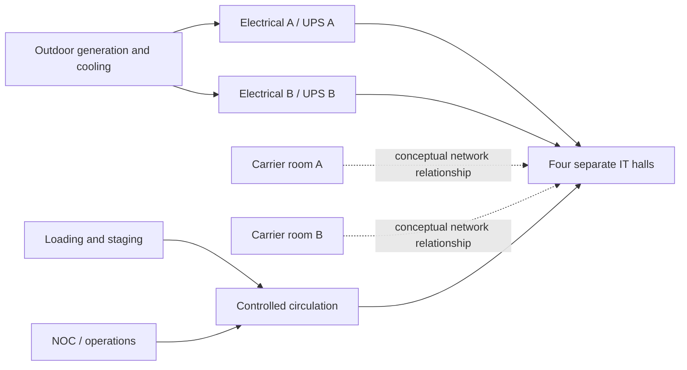

# Research and design basis: a larger datacenter fixture

Researched October 15, 2026. This is an original, schematic regional colocation/enterprise concept, not a survey of a named operator's building or construction documentation. Sources establish examples and design principles; the dimensions in the proposed layout below are explicit fixture choices. Implementation status is tracked in [the recipe](datacenter.md) and [the roadmap](../ROADMAP.md).

The requested visual implementation is now available at `/examples/datacenter`; [ADR 0020](../decisions/0020-datacenter-facility.md) records adoption of this layout and its limits. The following sections preserve the research/design basis, rather than claiming an engineered as-built facility.

## Findings from primary sources

| Source | Evidence used | Consequence for this scene |
| --- | --- | --- |
| [DOE/NREL, Best Practices Guide, revised July 2024](https://datacenters.lbl.gov/sites/default/files/2025-07/best-practice-guide-data-center-design.pdf) | Front-to-back equipment airflow, alternating intake/exhaust aisles, separation of return air and supply, and blanking unused rack spaces | Facing rack pairs, distinct cold and warm aisles; decorative containment, not CFD |
| [CONTEG contained cold aisle](https://www.conteg.com/solutions/contained-cold-aisle) | Manufacturer lists standard aisle widths of 1.2 or 1.8 m and end doors | Choose 1.8 m cold aisles, framed end doors and transparent roof modules |
| [Schneider reference-design scope](https://blog.se.com/datacenter/architecture/2012/10/09/benefits-and-essential-elements-of-a-data-center-reference-design/) | Complete-facility reference designs cover electrical, mechanical and IT spaces | Separate halls, electrical/UPS/battery rooms, cooling plant and circulation |
| [Schneider Reference Design 65](https://www.se.com/us/en/download/document/RD65DSR0_EN/) | Published example: 5.2 MW, pod-based build, chilled water, 85,000 sq ft | Modular halls and a distinct plant yard; this example's power is not a universal size rule |
| [Equinix Denver DE1](https://www.equinix.com/data-centers/americas-colocation/united-states-colocation/denver-data-centers/de1) | Operator lists 1,125 m² colocation space, UPS/generator/cooling systems, security and operator amenities | A regional facility can have IT space of this order; IT area is distinct from gross building/site area |
| [CE Colo DC7](https://www.cecolo.com/dc7), [operator service description](https://www.cecolo.com/documents/Service_Description_DC.pdf) | Czech operator lists two sets of four 350 m² halls, 2,800 m² IT space and 9,000 m² premises, plus storage and offices | Include staging, operations and carrier rooms rather than filling the entire building with racks |
| [Schneider NetShelter AR3300](https://www.se.com/de/de/product/AR3300/netshelter-sx-geh%C3%A4use-42-he-600-mm-b-x-1200-mm-t-mit-schwarzen-seitenteilen/) | Example 42U enclosure has a 600 × 1,200 mm footprint | Real rack dimensions vary. Retain the catalog's documented 0.86 × approximately 0.93 m schematic cabinet; do not claim it is this vendor enclosure |
| [Caterpillar D500 GC](https://www.cat.com/en_US/products/new/power-systems/electric-power/diesel-generator-sets/105443.html), [Vertiv Liebert HPC-S](https://www.vertiv.com/en-us/products-catalog/thermal-management/free-cooling-chillers/liebert-hpc-s---air-cooled-freecooling-and-adiabatic-freecooling-chillers/) | Examples of packaged standby generation and outdoor air-cooled/free-cooling chillers | Add generic enclosure/exhaust and roof-fan silhouettes, without vendor ratings or capacity inferred from geometry |
| [Uptime Institute design certification](https://uptimeinstitute.com/tier-certification/design) | Certification examines mechanical, electrical, structural and site criteria | A/B room labels alone do not establish Tier III/IV, 2N, N+1, uptime or certified resilience |

There is no single standard datacenter size. These sources range from a regional colocation footprint to multi-megawatt modular designs. Area, rack positions, installed IT load and utility/plant capacity are separate measures. The fixture's rack count and generated readings are fictional host records, not operator telemetry.

## Chosen dimensions and room schedule

- Site: **106 × 90 m**, centred on the building's axis at x = 2, including service access and outdoor plant.
- Building: **68 × 48 m = 3,264 m² gross schematic footprint**, single storey, 5.5 m nominal height.
- Four IT halls: **20 × 18 m = 360 m² each**, **1,440 m² combined room footprint**. These room dimensions include their schematic walls, rather than claiming a measured net usable area.
- Initial fit-out: **32 rack records per hall, 128 total**. Each hall has four rows of eight cabinets; the rest includes circulation, in-row cooling and an explicitly reserved growth strip. Floor reservation does not establish future power or rack capacity.
- Cold aisles: **1.8 m** chosen from the manufacturer's listed options; hot aisle: **1.2 m**, a fixture service-clearance choice. Local egress, maintenance and electrical clearances need a real design review; no code compliance is claimed.
- Rack depth remains approximately 0.93 m, with row centers chosen to keep those aisle gaps. Rack width/height/depth are geometry dimensions, never quantity encodings.

The fictional building spans x = −32…36 m, z = −24…24 m. North is −z. Its center spine spans x = 0…4 m and the cross corridor z = −4…4 m.

| Space | Center x,z (m) | Width × depth (m) | Purpose and adjacency |
| --- | --- | --- | --- |
| Hall 01 | −10, −13 | 20 × 18 | First IT module; cold-aisle pairs and growth floor |
| Hall 02 | 14, −13 | 20 × 18 | Second IT module |
| Hall 03 | −10, 13 | 20 × 18 | Third IT module |
| Hall 04 | 14, 13 | 20 × 18 | Fourth IT module |
| Electrical A / B | −26 / 30, −17 | 12 × 10 each | Opposite-side switchgear rooms, toward plant yard |
| UPS A / B | −26 / 30, −7 | 12 × 8 each | UPS equipment separated from the IT halls |
| Carrier A / B | −26 / 30, 1 | 12 × 6 each | Two meet-me/carrier rooms; no live fiber topology inferred |
| NOC | −26, 9 | 12 × 8 | Operator desks and status wall near staffed entrance |
| Staging | −26, 18 | 12 × 8 | Delivery, unpacking, spares and preparation; adjacent exterior apron |
| Battery A / B | 30, 9 / 18 | 12 × 8 each | Dedicated battery-room visual zones; no chemistry, fire-rating or runtime claim |
| Plant yard | 2, −32 | 64 × 16 | Three generic generator enclosures and three air-cooled chillers in one row, between the ring road and the north wall |

The site around the building is one plan ([ADR 0073](../decisions/0073-datacenter-site-and-room-focus.md)): a ring road with tile centres at x = −40 and 44, z = −43 and 35; a fence at x = −49 and 53, z = −47 and 40, with a 6 m entrance on the axis; and a service apron, entrance path and staff parking between the south wall and the road.

The diagram is an adjacency concept, not an electrical/piping single-line design:

## Catalog and rendering plan

Reuse `building`, `floor`, `terrain`, `wall-segment`, `equipment-cabinet`, `rack-server`, `network-switch`, `cooling-unit`, `ups-unit`, `desk-pod`, `information-board`, `shelf`, `pallet`, `loading-dock`, `delivery-van`, `potted-plant` and `map-pin` before adding models.

Concrete missing shared silhouettes: `generator-set`, `air-cooled-chiller`, `electrical-switchgear`, `battery-bank`, and `aisle-containment` (end portal / roof module). These are catalog additions only once implemented, documented and checked. They need semantic palettes, partial materials/color overrides, useful static geometry, host-health indicators, base-center pivots, bounds and connection anchors. None should calculate redundancy, fuel, cooling duty or charge. Fixed decorative fans/modules are not count controls.

The cabinet needs a documented **overview** variant that retains its dimensions, mounted-unit count and LED semantics with fewer structural details. The detailed variant remains compatible. Facility overview shows all room cutaways and compact racks; room focus keeps every room open and uses detailed racks in the selected room ([ADR 0073](../decisions/0073-datacenter-site-and-room-focus.md)). One shared scene/store serves native JS/React/Vue. All source records remain available in a paginated HTML table; focusing changes detail, never totals or identity.

Keep compact colored alert icons and hover/focus descriptions. Selection from the queue or table should open the relevant room before framing its equipment. Include explicit facility/room controls for keyboard and touch, and preserve count/motion/scenario controls on remount. Publish software-renderer diagnostics and geometry counts with their exclusions; hardware FPS and maximum capacity remain unmeasured.
